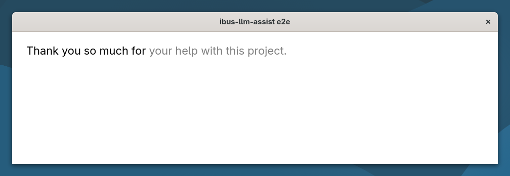
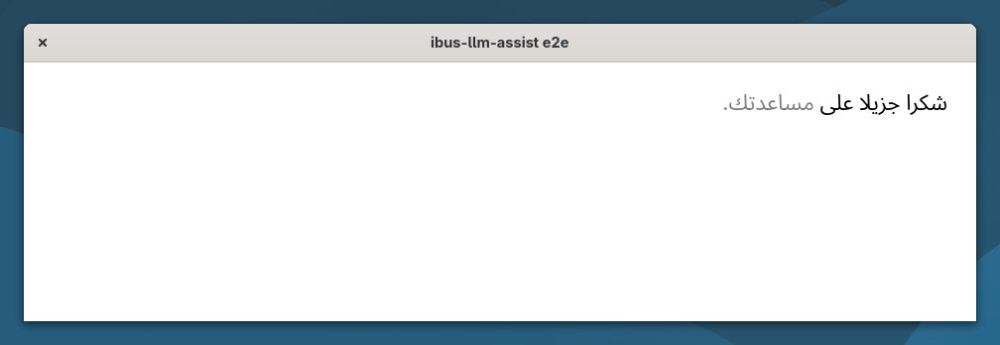
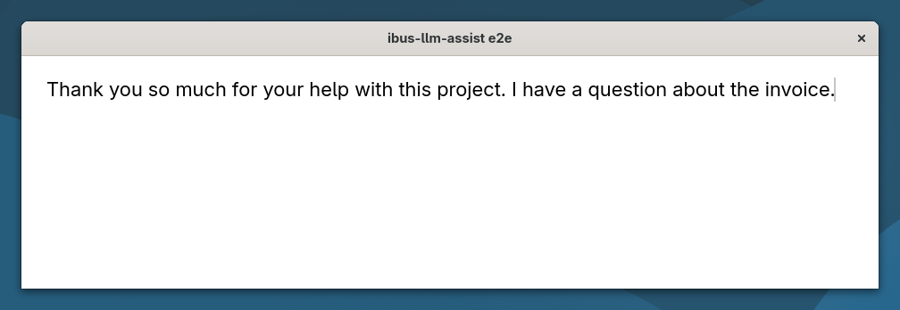
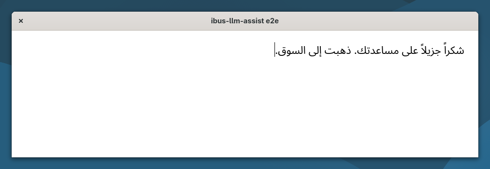

# ibus-llm-assist

**L'autocomplétion en ligne et la correction de vos phrases dans vos applications Linux, par un modèle de langage qui
tourne sur votre propre ordinateur.**

[](https://github.com/maximeallanic/ibus-llm-assist/actions/workflows/ci.yml)
[](LICENSE)
[](docs/compatibility.md)
[](docs/privacy.md)

[English](README.md) | Français

<p align="center">
  
  <br><sub>Enregistrement réel d'une session GNOME 51, à vitesse réelle, sans retouche (<a href="screenshots/README.md">comment il a été fait</a>).</sub>
</p>

- **Marquez une pause, et la suite de votre phrase s'affiche** en gris après le curseur. **Ctrl+Tab** la prend, ou
  continuez simplement à taper.
- **Terminez une phrase, et ses fautes sont corrigées** sur place : orthographe, grammaire, accords, ponctuation,
  accents. **Ctrl+Z** rend ce que vous aviez tapé.
- **Rien ne quitte votre machine.** Le modèle par défaut est Gemma 4 E2B sur llama.cpp, à l'écoute sur 127.0.0.1.
  Pas de compte, pas de service en ligne.

C'est une méthode de saisie IBus : elle marche dans les applications que vous utilisez déjà (applications GTK 4, y
compris en Flatpak, Chrome) sans greffon par application, et dans toutes les langues que le modèle écrit, sans
réglage.

## Démarrage rapide

Sous GNOME (Wayland), depuis un terminal de votre session de bureau, avec votre compte (pas en root) :

```sh
curl -fsSL https://raw.githubusercontent.com/maximeallanic/ibus-llm-assist/main/install.sh | bash
```

L'installateur dit ce que fait chaque étape et demande avant : paquets système, moteur sous `/usr/local` (sudo),
serveur de modèle local en option (llama.cpp et Gemma 4 E2B, 3,4 Go, versions fixées et vérifiées par sha256, lancé
comme service utilisateur sans root), puis il active le moteur pour vos dispositions de clavier et vérifie le
résultat. Ensuite, tapez dans n'importe quel champ de texte.

- Vous préférez lire avant ? `git clone https://github.com/maximeallanic/ibus-llm-assist`, puis
  `./install.sh --dry-run`. La ligne unique télécharge une version figée et vérifie son sha256
  avant de la lancer ([installation](docs/installation.md#one-line)).
- Vous avez déjà llama-server ? Ajoutez `-s -- --endpoint http://127.0.0.1:PORT` après `bash`.
- Tout défaire : la même ligne avec `bash -s -- --uninstall` (`--purge` supprime aussi le modèle). Vérifier une
  installation : `ibus-llm-assist status`.

## Pourquoi

L'autocomplétion locale, en ligne et dans toutes les applications existe sur macOS (Cotypist, par exemple). Sous
Linux, les outils voisins réécrivent une sélection sur un raccourci, vérifient la grammaire dans un éditeur ou le
navigateur, ou complètent des mots isolés à partir d'un dictionnaire. À notre connaissance, aucun ne propose la suite
de votre phrase en texte fantôme partout où vous tapez.

Chaque application qui passe par IBus confie déjà ses frappes et le texte autour du curseur à la méthode de saisie.
Placer le modèle à cet endroit, c'est une seule installation pour toutes ces applications, et un texte qui ne passe ni
par une extension de navigateur ni par un service en ligne.

## Ce que vous y gagnez

- **Des suggestions qui ne cassent pas votre élan.** Après une courte pause (400 ms par défaut), le moteur propose la
  fin de la phrase. Ctrl+Tab accepte, Échap efface, et taper les mêmes lettres la conserve. Sans suggestion affichée,
  Ctrl+Tab va à l'application comme d'habitude.
- **Des corrections qui ne vous réécrivent pas.** Une phrase est corrigée quand vous la terminez, en changeant le moins
  possible. Un garde-fou écarte toute réponse qui change plus de 30 % de la phrase : le modèle corrige, il ne reformule
  pas.
- **Votre disposition de clavier reste.** Le moteur prend la place de chacune de vos dispositions et en garde les
  touches, les touches mortes et les séquences Compose.
- **Discret là où il faut.** Il ne s'active jamais dans les champs de mot de passe, de code PIN ou privés, ni dans les
  terminaux.
- **Deux interrupteurs**, Suggestions et Corrections, dans le menu clavier de la barre du haut.
- **Le modèle de votre choix.** Tout modèle de conversation servi par llama-server. Les autres serveurs compatibles
  OpenAI (Ollama, vLLM, LM Studio…) sont une option **expérimentale**, testée contre un serveur factice et pas encore
  contre ces serveurs ([configuration](docs/configuration.md#other-servers)).

## Un seul moteur, toutes les langues du modèle

Rien dans le moteur ne dépend d'une langue : les limites de phrase et de mot viennent de Pango (règles Unicode), les
consignes ne nomment aucune langue, et les seuils se comptent en graphèmes et en octets. Il suit la langue dans
laquelle vous tapez, et l'écriture de droite à gauche marche. Les trois colonnes ci-dessous sont le même test de bout
en bout, lancé dans trois sessions :

| Anglais (`us`) | Français (`fr`, touches mortes) | Arabe (`ara`, de droite à gauche) |
|---|---|---|
|  |  |  |
|  |  |  |

Enregistrements : [anglais](screenshots/en-demo.gif) · [français](screenshots/fr-demo.gif) ·
[arabe](screenshots/ar-demo.gif). Les [bancs d'essai](docs/benchmarks.md) couvrent aussi le japonais. Les langues
tapées par une méthode de saisie ne sont pas encore prises en charge ([limites](#limites)).

## Confidentialité

- Le moteur envoie au serveur configuré le texte autour du curseur (la phrase en cours et jusqu'à trois phrases avant),
  et rien d'autre : pas de texte après le curseur, pas de nom de fenêtre ou d'application, pas d'identifiant.
- Il ne garde rien, n'écrit rien sur le disque et ne journalise aucun texte.
- Le serveur par défaut n'écoute que sur 127.0.0.1, et sa réponse CORS n'autorise que les origines `localhost` : les
  pages web que vous visitez ne peuvent pas lire ses réponses.
- Vous pouvez le faire pointer vers une autre machine ; `ibus-llm-assist status` vous prévient alors que votre frappe
  y part.

Détails : [docs/privacy.md](docs/privacy.md).

## Performances et prérequis

D'après le banc d'essai du dépôt ([docs/benchmarks.md](docs/benchmarks.md)) : Gemma 4 E2B (q4_0) sur llama.cpp,
Intel Iris Xe (i7-1265U), sur secteur, avec 8 débuts à compléter, 8 phrases fautives et 4 phrases correctes par
langue.

| Conditions | Suggestion, médiane | Bonnes corrections | Phrases correctes laissées intactes |
|---|---|---|---|
| Machine au calme (18/10/2026) | 0,65 s à 0,97 s selon la langue | 8/8 en français, anglais, arabe ; 7/8 en japonais | 4/4 dans toutes les langues |
| Plusieurs autres tâches GPU en cours (20/10/2026) | 2,01 s à 2,83 s | identiques | identiques |

Petits échantillons, une seule machine : c'est un ordre de grandeur, et `dev/bench/run.py` le mesure chez vous.

- **Bureau** : GNOME sous Wayland, testé avec GNOME 51 (Debian testing). IBus 1.5, Python 3.10+, PyGObject,
  libsoup 3. L'installateur gère apt, dnf et pacman (vérifiés dans des conteneurs en CI ; testé sur un vrai bureau
  sous Debian seulement).
- **Serveur local** : environ 5 Go de mémoire tant que le modèle est chargé. Il se décharge après cinq minutes
  d'inactivité, donc la première suggestion après une pause prend quelques secondes. Un GPU utilisable par Vulkan
  (Intel, AMD, NVIDIA) donne des suggestions rapides ; le processeur suffit, plus lentement.

## Ce qui marche sans correctif

Tout marche avec GNOME 51 et GTK 4.24 d'origine, sauf deux cas qui demandent un paquet recompilé
([docs/patches.md](docs/patches.md) ; les correctifs sont dans [`patches/`](patches) et ne sont pas encore en amont) :

| Vous utilisez | GNOME 51 / GTK 4.24 d'origine | Correctif |
|---|---|---|
| Une disposition sans variante (`fr`, `de`, `us`, `ara`, `ru`…) | Marche | aucun |
| Une disposition avec variante (`us+intl`, `fr+bepo`…) | GNOME Shell tape avec la disposition de base : l'installateur laisse ces dispositions telles quelles | [gnome-shell](patches/gnome-shell) |
| Texte fantôme translucide dans les champs d'une ligne (GtkEntry, recherche) | Marche, avec la [règle CSS](docs/configuration.md#look-of-the-suggestion) | aucun |
| Texte fantôme translucide dans les champs multilignes (GtkTextView) | Suggestion en italique, opaque | [gtk4](patches/gtk4) |

Les enregistrements ci-dessus ont été faits avec les deux correctifs et la règle CSS.

## Limites

- **Langues à méthode de saisie** (chinois, japonais, coréen, vietnamien en Telex…) : pas encore. IBus ne fait tourner
  qu'un moteur à la fois, et celui-ci ne compose pas. Les dispositions tapées directement (latin, cyrillique, grec,
  arabe, hébreu, devanagari, thaï…) marchent.
- **Thaï, lao, khmer, birman** : pas de suggestion au milieu d'un mot, car Pango n'y trouve les fins de mot qu'avec un
  dictionnaire qu'il n'a pas ; les suggestions après une espace ou une ponctuation marchent.
- **La qualité suit le modèle.** Gemma 4 E2B est petit : il a manqué une correction japonaise sur huit au banc
  d'essai, et il lui arrive de n'avoir aucune suggestion. Un modèle plus gros fait mieux, au prix de la vitesse.
- **Chrome** souligne la suggestion, opaque : il ignore l'indice « prediction » du protocole de saisie de Wayland.
- **GTK 3, Qt, Electron, Firefox** : non testés. **Autres bureaux** (KDE Plasma…) : le moteur s'ajoute avec
  `ibus-setup`, sans test.
- **Mode compatible OpenAI** : expérimental (voir plus haut).
- **Les messages** de l'installateur et du moteur existent en anglais et en français ; les autres langues retombent
  sur l'anglais.

Plus : [docs/compatibility.md](docs/compatibility.md), [docs/troubleshooting.md](docs/troubleshooting.md). La
documentation détaillée est en anglais.

## Comparaison

Vérifiée le 20/10/2026 sur les pages de chaque projet. Les corrections sont bienvenues.

| | Propose la suite du texte en ligne | Corrige votre texte | Où | Langues | Local |
|---|---|---|---|---|---|
| **ibus-llm-assist** | oui, texte fantôme, Ctrl+Tab | oui, automatiquement à la fin de chaque phrase | applications passant par IBus sous GNOME (GTK 4 et Chrome testés) | toutes celles du modèle ; pas encore les langues à méthode de saisie | oui, par défaut |
| [ibus-typing-booster](https://mike-fabian.github.io/ibus-typing-booster/) | complétion de mots, d'après votre historique et les dictionnaires Hunspell | suggestions orthographiques (Hunspell) | applications passant par IBus | presque toutes, sauf le chinois et le japonais | oui |
| [Writing Tools](https://github.com/theJayTea/WritingTools) | non | relit ou réécrit une sélection sur un raccourci | tout le système ; sous Linux « en cours », marche bien sous X11 | selon le modèle | en option (Ollama, llama.cpp…) ou en ligne |
| [LanguageTool](https://dev.languagetool.org/http-server) | non | vérification par règles | module de navigateur, LibreOffice 7.4+ | nombreuses | serveur local en option (Java) |
| [Harper](https://github.com/Automattic/harper) | non | vérification grammaticale | éditeurs (VS Code, Neovim, Helix, Emacs, Zed, Obsidian) | anglais | oui |
| [Cotypist](https://cotypist.app/press) | oui | non annoncé | la plupart des applications macOS, macOS seulement | non précisé | oui (llama.cpp, Gemma 4) ; gratuit limité, puis payant |

LanguageTool ou Harper dans un éditeur ne le gênent pas. ibus-typing-booster est lui aussi un moteur IBus : on choisit
l'un des deux par source de saisie.

## Questions fréquentes

**Ce que je tape quitte-t-il mon ordinateur ?** Pas avec l'installation par défaut : le modèle tourne sur 127.0.0.1
([confidentialité](docs/privacy.md)).

**Pourquoi Ctrl+Tab et pas Tab ?** Tab sert déjà au focus, à l'indentation ou à la complétion dans la plupart des
champs. Ctrl+Tab va à l'application comme d'habitude quand aucune suggestion n'est affichée.

**Pourquoi remplace-t-il ma disposition de clavier dans les sources de saisie ?** IBus ne fait tourner qu'un moteur à
la fois, et c'est ce moteur qui décide de la disposition. Le moteur prend donc la place de votre disposition et en
garde les touches ; `ibus-llm-assist disable` remet les dispositions d'origine.

**Est-ce un correcteur orthographique ?** Aucun dictionnaire n'intervient : le modèle lit la phrase entière, il corrige
donc aussi les accords et les mots qui existent mais sont faux, et il peut rater ce qu'un dictionnaire verrait.

**Puis-je utiliser un autre modèle ?** Oui, tout modèle de conversation sur llama-server : réglez `endpoint` dessus ou
modifiez le service du serveur. Gemma 4 E2B est le choix par défaut parce que, parmi les modèles comparés, c'était le
plus rapide à rester fiable dans toutes les langues du banc d'essai, et qu'il est sous Apache 2.0.

Plus dans [docs/faq.md](docs/faq.md) (en anglais).

## Réglages

Les interrupteurs sont dans le menu clavier. Le reste est dans GSettings :

```sh
gsettings set io.github.maximeallanic.IBusLlmAssist pause-ms 600                 # attendre plus avant de proposer
gsettings set io.github.maximeallanic.IBusLlmAssist endpoint 'http://127.0.0.1:8080'   # un autre llama-server
gsettings set io.github.maximeallanic.IBusLlmAssist server-api openai             # expérimental : autres serveurs
gsettings set io.github.maximeallanic.IBusLlmAssist model 'mon-modele'
```

Un serveur qui demande une clé la lit dans `~/.config/ibus-llm-assist/api-key` (mode 600).
[docs/configuration.md](docs/configuration.md) décrit les options du serveur et l'aspect de la suggestion.

## Pour l'améliorer

- **Essayez-le et racontez** comment ça s'est passé sur votre distribution, votre bureau et votre GPU :
  [ouvrez un ticket](https://github.com/maximeallanic/ibus-llm-assist/issues).
- **Vous utilisez Ollama, vLLM ou LM Studio ?** Un retour sur le mode compatible OpenAI, expérimental, est ce qui
  aiderait le plus en ce moment.
- **Les traductions** des messages de l'installateur et du moteur vont dans [`po/`](po)
  ([développement](docs/development.md)).
- Code : [CONTRIBUTING.md](CONTRIBUTING.md). Failles de sécurité : [SECURITY.md](SECURITY.md).

S'il vous épargne des frappes, une étoile aide d'autres utilisateurs de Linux à le trouver.

## Documentation

[Installation](docs/installation.md) · [Configuration](docs/configuration.md) · [Fonctionnement](docs/how-it-works.md) ·
[Compatibilité](docs/compatibility.md) · [Correctifs](docs/patches.md) · [Confidentialité](docs/privacy.md) ·
[Dépannage](docs/troubleshooting.md) · [FAQ](docs/faq.md) · [Bancs d'essai](docs/benchmarks.md) ·
[Développement](docs/development.md)

## Licence

MIT, voir [LICENSE](LICENSE). La mise en place du serveur local télécharge llama.cpp (MIT) et Gemma 4 E2B
(Apache 2.0), qui ne font pas partie de ce dépôt : [NOTICE.md](NOTICE.md).
