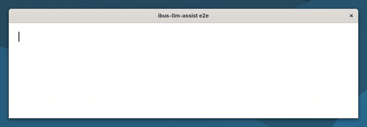
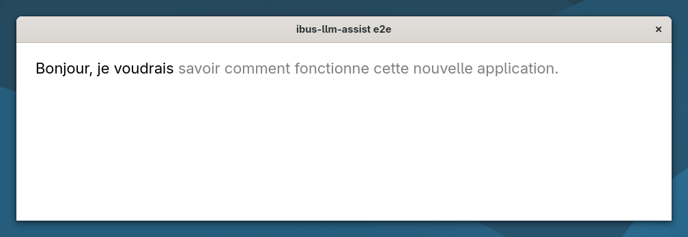
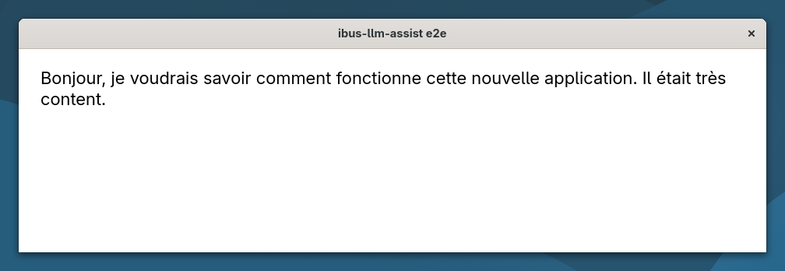
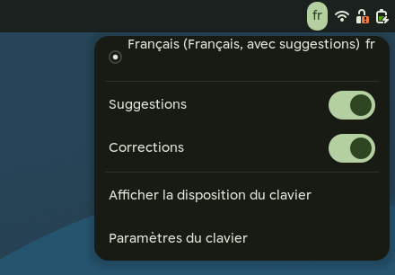

# ibus-llm-assist

[](https://github.com/maximeallanic/ibus-llm-assist/actions/workflows/ci.yml)
[](LICENSE)
[](docs/compatibility.md)
[](docs/privacy.md)

[English](README.md) | Français

Un moteur de saisie IBus qui **propose la suite de votre phrase** pendant que vous tapez et **corrige chaque phrase
terminée**, dans toutes les applications, avec un modèle de langage qui tourne sur votre propre ordinateur.
**Ctrl+Tab** accepte une suggestion, **Ctrl+Z** annule une correction.

<p align="center">
  
  <br><sub>Enregistrement réel d'une session GNOME 51, à vitesse réelle (<a href="screenshots/README.md">comment il a été fait</a>).</sub>
</p>

## Fonctions

- **Suggestions** après une courte pause de frappe, en texte fantôme après le curseur. Ctrl+Tab accepte, Échap
  efface, et taper les mêmes lettres la conserve.
- **Corrections** de l'orthographe, de la grammaire, des accords, de la ponctuation et des accents à la fin de chaque
  phrase, sur place, sans reformulation. Ctrl+Z juste après rend la phrase telle que vous l'avez tapée.
- **Toutes les langues du modèle.** Rien dans le moteur ne dépend d'une langue : les limites de phrase et de mot
  viennent de Pango (règles Unicode), les consignes ne nomment aucune langue, et les seuils se comptent en graphèmes et
  en octets. Mesuré en français, anglais, japonais et arabe ([bancs d'essai](docs/benchmarks.md)).
- **Votre disposition de clavier reste.** Le moteur prend la place de chacune de vos dispositions et en garde les
  touches, les touches mortes et les séquences Compose.
- **Privé.** Le serveur par défaut tourne sur 127.0.0.1. Ce que vous tapez ne part nulle part ailleurs, sauf si vous
  configurez vous-même un autre serveur, et `ibus-llm-assist status` vous prévient alors ([confidentialité](docs/privacy.md)).
- **Discret** dans les champs de mot de passe, de code PIN et privés, et dans les terminaux.
- Deux interrupteurs, **Suggestions** et **Corrections**, dans le menu clavier de la barre du haut.

| Suggestion | Correction | Menu |
|---|---|---|
|  |  |  |

## Installation

Sous GNOME, depuis un terminal de votre session de bureau, avec votre compte (pas en root) :

```sh
curl -fsSL https://raw.githubusercontent.com/maximeallanic/ibus-llm-assist/main/install.sh | bash
```

Le script télécharge la version publiée, puis demande avant chaque étape :

1. installe les paquets système manquants (apt, dnf ou pacman, vérifiés en CI ; zypper non testé),
2. installe le moteur sous `/usr/local` (sudo),
3. propose de mettre en place le serveur de modèle local : llama.cpp et Gemma 4 E2B (3,4 Go), téléchargés à des
   versions fixées, vérifiés par sha256, lancés comme service utilisateur sur 127.0.0.1:8033 (sans root),
4. active le moteur pour vos dispositions de clavier,
5. vérifie le résultat.

Vous avez déjà llama-server ? Ajoutez `-s -- --endpoint http://127.0.0.1:PORT` après `bash`. Les autres serveurs
compatibles OpenAI (Ollama, vLLM, LM Studio…) passent par `--server-api openai`, **expérimental** : testé contre un
serveur factice, pas encore contre ces serveurs ([configuration](docs/configuration.md#other-servers)). Depuis un
clone : `./install.sh` ; `./install.sh --help` liste les options. Détails : [docs/installation.md](docs/installation.md).

**Prérequis** : GNOME sous Wayland (testé avec GNOME 51), IBus 1.5, Python 3.10+, PyGObject, libsoup 3. Pour le
serveur local : environ 5 Go de mémoire libre, et un GPU utilisable par Vulkan pour des suggestions rapides (le
processeur suffit, plus lentement).

Désinstallation : la même ligne avec `bash -s -- --uninstall` (ou `./uninstall.sh` depuis un clone) ; `--purge`
supprime aussi le modèle. Vérification : `ibus-llm-assist status`.

## Ce qui marche sans correctif

Tout marche avec GNOME 51 et GTK 4 d'origine, sauf deux cas qui demandent un paquet corrigé
([docs/patches.md](docs/patches.md) ; les correctifs sont dans [`patches/`](patches)) :

| Vous utilisez | GNOME 51 / GTK 4.24 d'origine | Correctif |
|---|---|---|
| Une disposition sans variante (`fr`, `de`, `us`, `ara`, `ru`…) | Marche | aucun |
| Une disposition avec variante (`us+intl`, `fr+bepo`…) | GNOME Shell tape avec la disposition de base : l'installateur laisse ces dispositions telles quelles | [gnome-shell](patches/gnome-shell) |
| Texte fantôme translucide dans les champs d'une ligne (GtkEntry, recherche) | Marche, avec la [règle CSS](docs/configuration.md#look-of-the-suggestion) | aucun |
| Texte fantôme translucide dans les champs multilignes (GtkTextView) | Suggestion en italique, opaque | [gtk4](patches/gtk4) |

## Réglages

Les interrupteurs sont dans le menu clavier de la barre du haut. Le reste est dans GSettings :

```sh
gsettings set io.github.maximeallanic.IBusLlmAssist pause-ms 600                 # attendre plus avant de proposer
gsettings set io.github.maximeallanic.IBusLlmAssist endpoint 'http://127.0.0.1:8080'   # un autre llama-server
gsettings set io.github.maximeallanic.IBusLlmAssist server-api openai             # expérimental : autres serveurs
gsettings set io.github.maximeallanic.IBusLlmAssist model 'mon-modele'
```

Un serveur qui demande une clé la lit dans `~/.config/ibus-llm-assist/api-key` (mode 600). Voir
[docs/configuration.md](docs/configuration.md).

## Confidentialité

Le moteur voit ce que vous tapez dans les applications qui passent par IBus et envoie au serveur configuré le texte
autour du curseur (la phrase en cours et jusqu'à trois phrases avant), rien d'autre, et ne garde rien. Le serveur par
défaut n'écoute que sur 127.0.0.1. Le moteur ne s'active jamais dans les champs de mot de passe, de code PIN ou
privés, ni dans les terminaux. Le régler sur un serveur distant y envoie votre frappe : `ibus-llm-assist status` le
signale. [docs/privacy.md](docs/privacy.md).

## Limites

- **Méthodes de saisie** : les langues tapées par une méthode de saisie (chinois, japonais, coréen, vietnamien en
  Telex…) ne peuvent pas encore s'en servir : IBus ne fait tourner qu'un moteur à la fois, et celui-ci ne compose pas.
  Les dispositions tapées directement (latin, cyrillique, grec, arabe, hébreu, devanagari, thaï…) marchent.
- **Thaï, lao, khmer, birman** : pas de suggestion au milieu d'un mot, car Pango n'y trouve les fins de mot qu'avec un
  dictionnaire qu'il n'a pas ; les suggestions après une espace ou une ponctuation marchent.
- **Chrome** souligne la suggestion, opaque : il ignore l'indice « prediction » du protocole de saisie de Wayland.
- **Les messages** de l'installateur et du moteur existent en anglais et en français ; les autres langues retombent
  sur l'anglais.
- GNOME seulement. Les autres bureaux peuvent ajouter le moteur avec `ibus-setup`, sans test.

Plus : [docs/compatibility.md](docs/compatibility.md), [docs/troubleshooting.md](docs/troubleshooting.md),
[docs/faq.md](docs/faq.md). La documentation détaillée est en anglais.

## Documentation

[Installation](docs/installation.md) · [Configuration](docs/configuration.md) · [Fonctionnement](docs/how-it-works.md) ·
[Compatibilité](docs/compatibility.md) · [Correctifs](docs/patches.md) · [Confidentialité](docs/privacy.md) ·
[Dépannage](docs/troubleshooting.md) · [FAQ](docs/faq.md) · [Bancs d'essai](docs/benchmarks.md) ·
[Développement](docs/development.md)

## Licence

MIT, voir [LICENSE](LICENSE). La mise en place du serveur local télécharge llama.cpp (MIT) et Gemma 4 E2B
(Apache 2.0), qui ne font pas partie de ce dépôt : [NOTICE.md](NOTICE.md).
