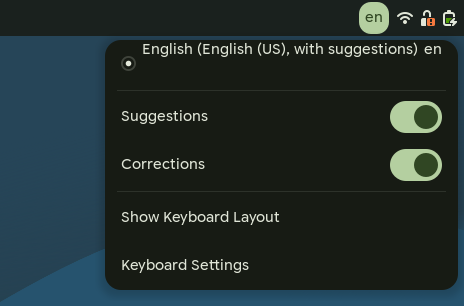

# ibus-llm-assist

[](https://github.com/maximeallanic/ibus-llm-assist/actions/workflows/ci.yml)
[](LICENSE)
[](docs/compatibility.md)
[](docs/privacy.md)

English | [Français](README.fr.md)

An IBus input engine that **suggests the rest of your sentence** as you type and **corrects each sentence you
finish**, in any application, with a language model that runs on your own computer. Press **Ctrl+Tab** to accept a
suggestion, **Ctrl+Z** to undo a correction.

<p align="center">
  
  <br><sub>Real recording of a GNOME 51 session, at real speed (<a href="screenshots/README.md">how it was made</a>).</sub>
</p>

## Features

- **Suggestions** after a short pause in your typing, shown as ghost text after the cursor. Ctrl+Tab accepts,
  Escape dismisses, and typing the same letters keeps it.
- **Corrections** of spelling, grammar, agreement, punctuation and accents when a sentence ends, in place, without
  rephrasing. Ctrl+Z right after brings the sentence back as you typed it.
- **Every language the model knows.** Nothing in the engine is tied to a language: sentence and word boundaries come
  from Pango (Unicode rules), the prompts name no language, and the limits are measured in graphemes and bytes.
  Measured in French, English, Japanese and Arabic ([benchmarks](docs/benchmarks.md)).
- **Your keyboard layout stays.** The engine takes the place of each of your layouts and keeps its keys, dead keys and
  Compose sequences.
- **Private.** The default server runs on 127.0.0.1. What you type is never sent anywhere else unless you configure
  another server yourself, and `ibus-llm-assist status` warns when you do ([privacy](docs/privacy.md)).
- **Stays out of the way** in password, PIN and private fields, and in terminals.
- Two switches, **Suggestions** and **Corrections**, in the keyboard menu of the top bar.

| Suggestion | Correction | Menu |
|---|---|---|
|  |  |  |

## Install

On GNOME, from a terminal of your desktop session, as yourself (not root):

```sh
curl -fsSL https://raw.githubusercontent.com/maximeallanic/ibus-llm-assist/main/install.sh | bash
```

It downloads the release, then asks before each step:

1. installs the missing system packages (apt, dnf or pacman, checked in CI; zypper untested),
2. installs the engine under `/usr/local` (sudo),
3. offers to set up the local model server: llama.cpp and Gemma 4 E2B (3.4 GB), downloaded at pinned versions,
   checked by sha256, run as a user service on 127.0.0.1:8033 (no root),
4. turns the engine on for your keyboard layouts,
5. checks the result.

Already run llama-server? Add `-s -- --endpoint http://127.0.0.1:PORT` after `bash`. Other OpenAI-compatible servers
(Ollama, vLLM, LM Studio…) work through `--server-api openai`, which is **experimental**: it is tested against a stub,
not yet against these servers ([configuration](docs/configuration.md#other-servers)). From a clone, run
`./install.sh`; `./install.sh --help` lists every option. Details: [docs/installation.md](docs/installation.md).

**Requirements**: GNOME on Wayland (tested on GNOME 51), IBus 1.5, Python 3.10+, PyGObject, libsoup 3. For the local
server: about 5 GB of free memory, and a GPU usable through Vulkan for fast suggestions (the processor works, slower).

Uninstall: the same line with `bash -s -- --uninstall` (or `./uninstall.sh` from a clone); add `--purge` to delete
the model too. Check an install: `ibus-llm-assist status`.

## What works without patches

Everything works on a stock GNOME 51 with stock GTK 4, with two exceptions that need a patched package
([docs/patches.md](docs/patches.md); the patches are in [`patches/`](patches)):

| You use | Stock GNOME 51 / GTK 4.24 | Patch |
|---|---|---|
| A layout without variant (`fr`, `de`, `us`, `ara`, `ru`…) | Works | none |
| A layout with a variant (`us+intl`, `fr+bepo`…) | GNOME Shell types with the plain layout, so the installer leaves these layouts alone | [gnome-shell](patches/gnome-shell) |
| Translucent ghost text in single-line fields (GtkEntry, search fields) | Works, with the [CSS rule](docs/configuration.md#look-of-the-suggestion) | none |
| Translucent ghost text in multi-line fields (GtkTextView) | Suggestion in italic, at full opacity | [gtk4](patches/gtk4) |

## Configure

The switches are in the keyboard menu of the top bar. Everything else is in GSettings:

```sh
gsettings set io.github.maximeallanic.IBusLlmAssist pause-ms 600                 # wait longer before suggesting
gsettings set io.github.maximeallanic.IBusLlmAssist endpoint 'http://127.0.0.1:8080'   # another llama-server
gsettings set io.github.maximeallanic.IBusLlmAssist server-api openai             # experimental: other servers
gsettings set io.github.maximeallanic.IBusLlmAssist model 'my-model'
```

A server that needs a key reads it from `~/.config/ibus-llm-assist/api-key` (mode 600). See
[docs/configuration.md](docs/configuration.md) for the server options and the look of the suggestion.

## Privacy

The engine sees what you type in the applications that use IBus, and sends the current text around the cursor (the
sentence being typed and up to three before it) to the configured server, nothing else, and keeps nothing. The default
server listens on 127.0.0.1 only. The engine never runs in password, PIN or private fields,
nor in terminals. Pointing it at a remote server sends your typing there: `ibus-llm-assist status` says so.
[docs/privacy.md](docs/privacy.md).

## Limitations

- **Input methods**: languages typed through an input method (Chinese, Japanese, Korean, Vietnamese Telex…) cannot
  use it yet: IBus runs one engine at a time, and this one does not compose. Layouts typed directly (Latin, Cyrillic,
  Greek, Arabic, Hebrew, Devanagari, Thai…) work.
- **Thai, Lao, Khmer, Burmese**: no suggestion in the middle of a word, because Pango finds word ends there only with a
  dictionary it does not have; suggestions after a space or punctuation work.
- **Chrome** shows the suggestion underlined at full opacity: it ignores the "prediction" hint of the Wayland
  text-input protocol.
- **Messages** of the installer and the engine are in English and French; other languages fall back to English.
- GNOME only. Other desktops can add the engine with `ibus-setup`, untested.

More: [docs/compatibility.md](docs/compatibility.md), [docs/troubleshooting.md](docs/troubleshooting.md),
[docs/faq.md](docs/faq.md).

## Documentation

[Installation](docs/installation.md) · [Configuration](docs/configuration.md) · [How it works](docs/how-it-works.md) ·
[Compatibility](docs/compatibility.md) · [Patches](docs/patches.md) · [Privacy](docs/privacy.md) ·
[Troubleshooting](docs/troubleshooting.md) · [FAQ](docs/faq.md) · [Benchmarks](docs/benchmarks.md) ·
[Development](docs/development.md)

## License

MIT, see [LICENSE](LICENSE). The local server setup downloads llama.cpp (MIT) and Gemma 4 E2B (Apache 2.0), which
are not part of this repository: [NOTICE.md](NOTICE.md).
