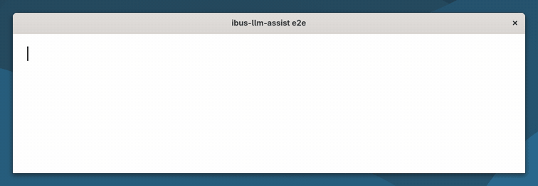

# ibus-llm-assist

**Inline autocomplete and sentence correction in your Linux apps, from a language model that runs on your own
computer.**

[](https://github.com/maximeallanic/ibus-llm-assist/actions/workflows/ci.yml)
[](LICENSE)
[](docs/compatibility.md)
[](docs/privacy.md)

English | [Français](README.fr.md)

<p align="center">
  
  <br><sub>Real recording of a GNOME 51 session, at real speed, nothing retouched (<a href="screenshots/README.md">how it was made</a>).</sub>
</p>

- **Pause, and the rest of your sentence appears** in grey after the cursor. **Ctrl+Tab** takes it, or just keep
  typing.
- **Finish a sentence, and its mistakes are fixed** in place: spelling, grammar, agreement, punctuation, accents.
  **Ctrl+Z** puts back what you typed.
- **Nothing leaves your machine.** The default model is Gemma 4 E2B on llama.cpp, listening on 127.0.0.1. No account,
  no cloud service.

It is an IBus input method, so it works in the applications you already use (GTK 4 apps, Flatpak GTK 4 apps, Chrome)
with no plugin per application, and in every language the model writes, with no setting.

## Quick start

On GNOME (Wayland), from a terminal of your desktop session, as yourself (not root):

```sh
curl -fsSL https://raw.githubusercontent.com/maximeallanic/ibus-llm-assist/main/install.sh | bash
```

The installer says what each step does and asks before it: system packages, the engine under `/usr/local` (sudo), the
optional local model server (llama.cpp and Gemma 4 E2B, 3.4 GB, pinned and checked by sha256, run as a user service
without root), then it turns the engine on for your keyboard layouts and checks the result. Then type in any text
field.

- Rather read it first? `git clone https://github.com/maximeallanic/ibus-llm-assist`, then `./install.sh --dry-run`.
  The one-liner downloads a pinned release and checks its sha256 before running it
  ([installation](docs/installation.md#one-line)).
- Already running llama-server? Add `-s -- --endpoint http://127.0.0.1:PORT` after `bash`.
- Undo it all: the same line with `bash -s -- --uninstall` (`--purge` also deletes the model). Check an install:
  `ibus-llm-assist status`.

## Why

Inline, local autocomplete across apps exists on macOS (Cotypist, for one). On Linux, the tools nearby rewrite a
selection on a hotkey, check grammar inside one editor or the browser, or complete single words from a dictionary.
As far as we found, none suggests the rest of your sentence as ghost text wherever you type.

Every application that uses IBus already hands its keystrokes and the text around the cursor to the input method.
Putting the model there means one install covers those apps, and your text never goes through a browser extension or
a cloud service.

## What you get

- **Suggestions that keep your flow.** After a short pause (400 ms by default), the engine proposes the end of the
  sentence. Ctrl+Tab accepts, Escape dismisses, and typing the same letters keeps it. When no suggestion is shown,
  Ctrl+Tab goes to the application as usual.
- **Corrections that do not rewrite you.** A sentence is corrected when you end it, changing as little as possible. A
  guard drops any answer that changes more than 30 % of the sentence: the model fixes, it does not rephrase.
- **Your keyboard layout stays.** The engine stands in for each of your layouts and keeps its keys, dead keys and
  Compose sequences.
- **Quiet where it should be.** It never runs in password, PIN or private fields, nor in terminals.
- **Two switches**, Suggestions and Corrections, in the keyboard menu of the top bar.
- **Bring your own model.** Any instruction-tuned chat model served by llama-server. Other OpenAI-compatible servers
  (Ollama, vLLM, LM Studio…) are an **experimental** option, tested against a stub server and not yet against those
  servers ([configuration](docs/configuration.md#other-servers)).

## One engine, every language the model writes

Nothing in the engine is tied to a language: sentence and word boundaries come from Pango (Unicode rules), the prompts
name no language, and the limits are counted in graphemes and bytes. It follows the language you are typing in, and
right-to-left text works. The three columns below are the same end-to-end test, run in three sessions:

| English (`us`) | French (`fr`, with dead keys) | Arabic (`ara`, right to left) |
|---|---|---|
|  |  |  |
|  |  |  |

Recordings: [English](screenshots/en-demo.gif) · [French](screenshots/fr-demo.gif) ·
[Arabic](screenshots/ar-demo.gif). The [benchmarks](docs/benchmarks.md) also cover Japanese. Languages typed through
an input method are not supported yet ([limitations](#limitations)).

## Privacy

- The engine sends the text around the cursor (the sentence being typed and up to three before it) to the configured
  server, and nothing else: no text after the cursor, no window or application name, no identifier.
- It keeps nothing, writes nothing to disk and logs no text.
- The default server listens on 127.0.0.1 only, and its CORS answer allows only `localhost` origins, so the web pages
  you visit cannot read its answers.
- You can point it at another machine; `ibus-llm-assist status` then warns that your typing goes there.

Details: [docs/privacy.md](docs/privacy.md).

## Performance and requirements

From the repository's own bench ([docs/benchmarks.md](docs/benchmarks.md)): Gemma 4 E2B (q4_0) on llama.cpp, Intel
Iris Xe (i7-1265U), on mains power, with 8 beginnings to complete, 8 sentences with a mistake and 4 correct sentences
per language.

| Condition | Suggestion, median | Right corrections | Correct sentences left alone |
|---|---|---|---|
| Quiet machine (2026-10-18) | 0.65 s to 0.97 s, depending on the language | 8/8 in French, English, Arabic; 7/8 in Japanese | 4/4 in every language |
| Several other GPU jobs running (2026-10-20) | 2.01 s to 2.83 s | the same | the same |

Small samples on one machine: read them as an order of magnitude, and run `dev/bench/run.py` on yours.

- **Desktop**: GNOME on Wayland, tested on GNOME 51 (Debian testing). IBus 1.5, Python 3.10+, PyGObject, libsoup 3.
  The installer handles apt, dnf and pacman (checked in CI containers; desktop-tested on Debian only).
- **Local server**: about 5 GB of memory while the model is loaded. It unloads after five idle minutes, so the first
  suggestion after a break takes a few seconds. A GPU usable through Vulkan (Intel, AMD, NVIDIA) gives fast
  suggestions; the processor works, slower.

## What works without patches

Everything works on stock GNOME 51 and GTK 4.24, with two exceptions that need a rebuilt package
([docs/patches.md](docs/patches.md); the patches are in [`patches/`](patches) and are not upstream yet):

| You use | Stock GNOME 51 / GTK 4.24 | Patch |
|---|---|---|
| A layout without variant (`fr`, `de`, `us`, `ara`, `ru`…) | Works | none |
| A layout with a variant (`us+intl`, `fr+bepo`…) | GNOME Shell types with the plain layout, so the installer leaves these layouts alone | [gnome-shell](patches/gnome-shell) |
| Translucent ghost text in single-line fields (GtkEntry, search fields) | Works, with the [CSS rule](docs/configuration.md#look-of-the-suggestion) | none |
| Translucent ghost text in multi-line fields (GtkTextView) | Suggestion in italic, at full opacity | [gtk4](patches/gtk4) |

The recordings above were made with both patches and the CSS rule.

## Limitations

- **Input-method languages** (Chinese, Japanese, Korean, Vietnamese Telex…) cannot use it yet: IBus runs one engine
  at a time, and this one does not compose. Layouts typed directly (Latin, Cyrillic, Greek, Arabic, Hebrew,
  Devanagari, Thai…) work.
- **Thai, Lao, Khmer, Burmese**: no suggestion in the middle of a word, because Pango finds word ends there only with
  a dictionary it does not have; suggestions after a space or punctuation work.
- **Quality follows the model.** Gemma 4 E2B is small: it missed one Japanese correction out of eight in the bench,
  and now and then it has no suggestion. A bigger model does better, at the cost of speed.
- **Chrome** shows the suggestion underlined at full opacity: it ignores the "prediction" hint of the Wayland
  text-input protocol.
- **GTK 3, Qt, Electron, Firefox**: untested. **Other desktops** (KDE Plasma…) can add the engine with `ibus-setup`,
  untested.
- **OpenAI-compatible mode**: experimental (see above).
- **Messages** of the installer and the engine are in English and French; other languages fall back to English.

More: [docs/compatibility.md](docs/compatibility.md), [docs/troubleshooting.md](docs/troubleshooting.md).

## How it compares

Checked on 2026-10-20 from each project's own pages. Corrections welcome.

| | Suggests the rest of the text inline | Corrects your text | Where | Languages | Local |
|---|---|---|---|---|---|
| **ibus-llm-assist** | yes, ghost text, Ctrl+Tab | yes, automatically at the end of each sentence | apps using IBus on GNOME (GTK 4 and Chrome tested) | any the model writes; not input-method languages yet | yes, by default |
| [ibus-typing-booster](https://mike-fabian.github.io/ibus-typing-booster/) | word completions, from your typing history and Hunspell dictionaries | spellcheck suggestions (Hunspell) | apps using IBus | nearly all, except Chinese and Japanese | yes |
| [Writing Tools](https://github.com/theJayTea/WritingTools) | no | proofreads or rewrites a selection on a hotkey | system-wide; on Linux "work in progress", works well on X11 | depends on the model | optional (Ollama, llama.cpp…) or cloud |
| [LanguageTool](https://dev.languagetool.org/http-server) | no | rule-based checking | browser add-on, LibreOffice 7.4+ | many | optional local server (Java) |
| [Harper](https://github.com/Automattic/harper) | no | grammar checking | editors (VS Code, Neovim, Helix, Emacs, Zed, Obsidian) | English | yes |
| [Cotypist](https://cotypist.app/press) | yes | not advertised | most macOS apps, macOS only | not stated | yes (llama.cpp, Gemma 4); freemium |

LanguageTool or Harper inside an editor do not get in its way. ibus-typing-booster is an IBus engine too: you choose
one of the two per input source.

## FAQ

**Does anything I type leave my computer?** Not with the default setup: the model runs on 127.0.0.1
([privacy](docs/privacy.md)).

**Why Ctrl+Tab and not Tab?** Tab already means focus, indentation or completion in most fields. Ctrl+Tab goes to the
application as usual whenever no suggestion is shown.

**Why does it replace my keyboard layout in the input sources?** IBus runs one engine at a time, and that engine
decides the layout. The engine stands in for your layout and keeps its keys; `ibus-llm-assist disable` puts the plain
layouts back.

**Is it a spell checker?** No dictionary is involved: the model reads the whole sentence, so it fixes agreement and
real-but-wrong words too, and it can miss things a dictionary would catch.

**Can I use another model?** Yes, any instruction-tuned chat model on llama-server: point `endpoint` at it or edit the
server unit. Gemma 4 E2B is the default because, among the models compared, it was the fastest that stayed reliable in
every language of the bench, and it is under Apache 2.0.

More in [docs/faq.md](docs/faq.md).

## Configure

The switches are in the keyboard menu. Everything else is in GSettings:

```sh
gsettings set io.github.maximeallanic.IBusLlmAssist pause-ms 600                 # wait longer before suggesting
gsettings set io.github.maximeallanic.IBusLlmAssist endpoint 'http://127.0.0.1:8080'   # another llama-server
gsettings set io.github.maximeallanic.IBusLlmAssist server-api openai             # experimental: other servers
gsettings set io.github.maximeallanic.IBusLlmAssist model 'my-model'
```

A server that needs a key reads it from `~/.config/ibus-llm-assist/api-key` (mode 600).
[docs/configuration.md](docs/configuration.md) covers the server options and the look of the suggestion.

## Help it get better

- **Try it and say how it went** on your distribution, desktop and GPU:
  [open an issue](https://github.com/maximeallanic/ibus-llm-assist/issues).
- **Ollama, vLLM or LM Studio user?** A report on the experimental OpenAI-compatible mode is the most useful thing
  right now.
- **Translations** of the installer and engine messages go in [`po/`](po) ([development](docs/development.md)).
- Code: [CONTRIBUTING.md](CONTRIBUTING.md). Security issues: [SECURITY.md](SECURITY.md).

If it saves you keystrokes, a star helps other Linux users find it.

## Documentation

[Installation](docs/installation.md) · [Configuration](docs/configuration.md) · [How it works](docs/how-it-works.md) ·
[Compatibility](docs/compatibility.md) · [Patches](docs/patches.md) · [Privacy](docs/privacy.md) ·
[Troubleshooting](docs/troubleshooting.md) · [FAQ](docs/faq.md) · [Benchmarks](docs/benchmarks.md) ·
[Development](docs/development.md)

## License

MIT, see [LICENSE](LICENSE). The local server setup downloads llama.cpp (MIT) and Gemma 4 E2B (Apache 2.0), which
are not part of this repository: [NOTICE.md](NOTICE.md).
